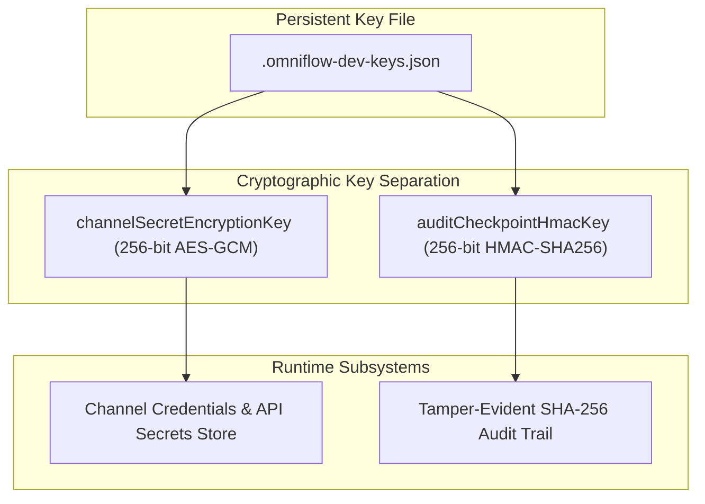

# OmniFlow OS — Cryptographic Key Management & NTFS Security Policy
**Project Identity:** `OMNIFLOW_OS`  
**Security Module:** `server/core/cryptoKeyPolicy.ts` & `server/core/channelCrypto.ts`  
**Key Storage:** `F:\Dev_Workspace\Data\OMNIFLOW_OS\.omniflow-dev-keys.json`  

---

## 1. Cryptographic Key Architecture

OmniFlow OS enforces cryptographic separation of concerns between data encryption and cryptographic audit integrity. The system utilizes two distinct keys:



### 1.1 `channelSecretEncryptionKey`
- **Purpose:** Authenticated encryption of sensitive channel credentials (WhatsApp access tokens, SIP trunk passwords, API keys) stored on disk.
- **Algorithm:** AES-256-GCM authenticated encryption.
- **Key Generation:** CSPRNG via `crypto.randomBytes(32).toString('hex')` (256 bits of entropy, represented as 64 lowercase hex characters).
- **Associated Authenticated Data (AAD):** Each encrypted field binds the tenant ID (`organizationId`) and channel ID to prevent cross-tenant ciphertext swapping.

### 1.2 `auditCheckpointHmacKey`
- **Purpose:** Cryptographic signing of append-only audit trail checkpoints.
- **Algorithm:** HMAC-SHA256.
- **Separation Guarantee:** In `generateDistinctKeyPair()`, an explicit loop guarantees that `auditCheckpointHmacKey !== channelSecretEncryptionKey`.

---

## 2. Key Durability & Cold Restart Invariants

### 2.1 Keyfile Persistence
In development and local-first production environments, keys are securely stored in:
`F:\Dev_Workspace\Data\OMNIFLOW_OS\.omniflow-dev-keys.json`
- **Creation Mode:** Created exclusively using flag `'wx'` (fails if file already exists to prevent race conditions).
- **Reloading:** On subsequent server starts, `ensureRuntimeCryptoKeys()` detects the existing keyfile, validates the 64-hex format and distinctness, and loads them into memory without mutation.

### 2.2 Fail-Closed Invariant on Missing Keys (`DEV_KEYS_MISSING_FOR_EXISTING_DB`)
- **Critical Safety Guard:** If `db_state.json` exists on disk but `.omniflow-dev-keys.json` is missing or unreadable, the system **REFUSES** to generate a new key pair silently.
- **Demonstrable Rationale:** Silently generating new encryption keys for an existing database would permanently orphan all existing encrypted channel secrets and corrupt the audit log HMAC chain. The server terminates immediately with:
  `[Fatal Crypto Policy] DEV_KEYS_MISSING_FOR_EXISTING_DB`

---

## 3. Windows NTFS Permissions & Host Security Analysis

### 3.1 Real NTFS Access Control List (ACL) Evaluation
An audit of the NTFS ACL on `F:\Dev_Workspace\Data\OMNIFLOW_OS\.omniflow-dev-keys.json` via PowerShell `Get-Acl` revealed:
- **File Owner:** `DESKTOP-TPRQE15\FAWZY SHETA`
- **Inherited Access Control Entries (ACEs):**
  - `BUILTIN\Administrators`: Allow FullControl
  - `NT AUTHORITY\SYSTEM`: Allow FullControl
  - `NT AUTHORITY\Authenticated Users`: Allow Modify, Synchronize
  - `BUILTIN\Users`: Allow ReadAndExecute, Synchronize

### 3.2 Application-Level Allowlisting vs OS-Level Isolation
- **Honest Boundary Disclosure:** The Node.js standard library `fs.openSync(path, 'wx', 0o600)` does not configure Windows Security Descriptors (DACLs). On Windows NTFS, mode `0o600` is advisory and maps only to the file's read-only attribute bit.
- **Current Protection Level:** **Application-Level Path Allowlisting**. The OmniFlow runtime enforces strict path boundaries, but Windows processes running under the same user account or other accounts in `BUILTIN\Users` have NTFS read permissions to the file.
- **Hardening Runbook for OS-Level Isolation:**
  If the operator requires operating-system-level isolation, run the following PowerShell command as Administrator to strip inherited DACLs and grant exclusive access to the current operator:
  ```powershell
  # Disable inheritance and grant exclusive access to current user only
  icacls "F:\Dev_Workspace\Data\OMNIFLOW_OS\.omniflow-dev-keys.json" /inheritance:r /grant:r "$($env:USERNAME):(F)" "SYSTEM:(F)"
  ```

---

## 4. Key Rotation & Disaster Recovery Policy

1. **Backup Alignment:** When creating a system backup (`F:\Dev_Workspace\Backups\OMNIFLOW_OS\`), the backup snapshot includes `.omniflow-dev-keys.json` alongside `db_state.json` to ensure restore fidelity.
2. **Key Rotation Protocol:** Key rotation requires an intentional operational migration command (`npm run migrate:keys`). The migration script:
   - Reads old keys.
   - Decrypts all existing channel secrets in memory using the old key.
   - Generates new 256-bit CSPRNG keys.
   - Re-encrypts all secrets with the new key and writes the new keyfile atomically.
   - Archives the previous keyfile with a timestamp.
3. **Lost Key Recovery Procedure:**
   - If the keyfile is accidentally deleted, restore `.omniflow-dev-keys.json` from the latest backup in `F:\Dev_Workspace\Backups\OMNIFLOW_OS\`.
   - Never delete an existing `db_state.json` to bypass a key mismatch error.
