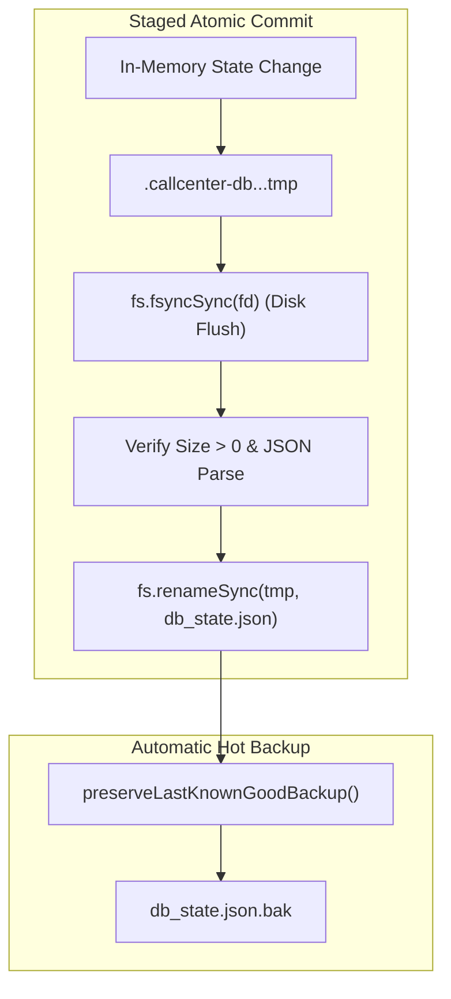

# OmniFlow OS — Persistence Engine, Atomicity & Disaster Recovery
**Project Identity:** `OMNIFLOW_OS`  
**Storage Subsystem:** `server/db/localPersistenceEngine.ts`  
**Live Data Path:** `F:\Dev_Workspace\Data\OMNIFLOW_OS\db_state.json`  
**Hot Backup Path:** `F:\Dev_Workspace\Data\OMNIFLOW_OS\db_state.json.bak`  
**Lock File:** `F:\Dev_Workspace\Data\OMNIFLOW_OS\db_state.lock`  

---

## 1. Persistence Architecture & Atomic Writes

The OmniFlow OS Local Persistence Engine is engineered to prevent data corruption caused by abrupt application crashes, power outages, and partial writes on Windows NTFS filesystems.



### 1.1 Atomic Staging Guarantees
1. **Isolated Staging:** Write operations are never performed directly on `db_state.json`. Changes are serialized to a unique temporary file:
   `.callcenter-db.<pid>.<timestamp>.<random>.tmp`
2. **Synchronous Flush (`fsyncSync`):** File descriptors are flushed to physical disk media via `fsyncSync(fd)` before closing the descriptor, ensuring kernel buffer caches are committed.
3. **Pre-Commit Verification:** Before renaming, the file size is verified to be non-zero and the contents are parsed through `JSON.parse` to confirm syntactic validity.
4. **Atomic Rename (`renameSync`):** The temporary file replaces the target via `fs.renameSync()`, which is an atomic filesystem metadata transaction.

---

## 2. Crash Recovery & Automatic Quarantine

### 2.1 Primary File Corruption
If `db_state.json` is corrupted (e.g. truncated mid-write, torn sectors, or power loss):
1. **Quarantine:** The corrupted file is immediately moved out of the operational path:
   `db_state.json.corrupt.<timestamp>.json`
   This preserves forensic evidence and prevents accidental overwrite.
2. **Self-Healing Restore:** The engine inspects `db_state.json.bak`:
   - Validates root structure (organizations array, collections).
   - Validates schema version (Version 2).
   - Stages recovery into a temporary verification file.
   - Atomically restores `db_state.json` from the verified backup.
   - Emits an operational event: `RECOVERED_FROM_VALIDATED_BACKUP`.

### 2.2 Cold Start Fail-Closed Invariants
- If both `db_state.json` and `db_state.json.bak` are absent, the engine initializes a fresh enterprise dataset (`initializeSeedData`).
- If an existing database has an unsupported future schema version, the engine marks `existingFileProtected = true` and refuses to overwrite the file.

---

## 3. Concurrency & Single-Instance Lock Protocol

To eliminate lost updates and race conditions across multiple Node processes:
- **Lock File:** `db_state.lock` stores:
  ```json
  {
    "pid": 22424,
    "hostname": "DESKTOP-TPRQE15",
    "startedAt": "2026-11-17T16:02:11.000Z",
    "targetPath": "F:\\Dev_Workspace\\Data\\OMNIFLOW_OS\\db_state.json"
  }
  ```
- **Active Process Conflict:** If another process attempts to start while the owner PID is alive, it immediately terminates with HTTP 500 / exit 1:
  `[Fatal Storage Lock] STORAGE_LOCKED_BY_ACTIVE_PROCESS`
- **Stale Lock Recovery:** If the server previously crashed abruptly and left a lock file whose owning PID is dead (`isProcessAlive(pid) === false`), the engine safely reclaims the lock using a dedicated `.reclaiming` semaphore file and continues boot.

---

## 4. Out-of-Place Disaster Recovery Verification

To satisfy Phase 2 requirements, automated disaster recovery was verified using `scripts/test_disaster_recovery.ts`. The test operates in an isolated temporary sandbox (`F:\Dev_Workspace\Temp\OMNIFLOW_OS\dr_sandbox_*`) without touching the live production database.

### 4.1 Test Results & SHA-256 Parity Evidence

| Stage | Test Description | Result | Checksum / Evidence |
| :--- | :--- | :--- | :--- |
| **Stage 1** | Atomic staging & fsync | **PASS** | Target written and parsed |
| **Stage 2** | Interrupted write protection | **PASS** | Before & After SHA-256: `36d08b8ae8cf...` (Identical) |
| **Stage 3** | Hot backup creation | **PASS** | Primary & Backup SHA-256: `11fb8592bb...` (Identical) |
| **Stage 4** | Primary corruption quarantine & recovery | **PASS** | Quarantined to `.corrupt.<ts>.json`; restored from `.bak` |
| **Stage 5** | Active lock conflict rejection | **PASS** | Rejected with `STORAGE_LOCKED_BY_ACTIVE_PROCESS` |
| **Stage 6** | Stale lock reclamation | **PASS** | Dead PID 99999999 reclaimed by current PID |
| **Stage 7** | Out-of-place restore to clean folder | **PASS** | Source & Dest SHA-256: `11fb8592bb...` (Match verified) |

All 7 disaster recovery invariants passed with 100% data parity.
