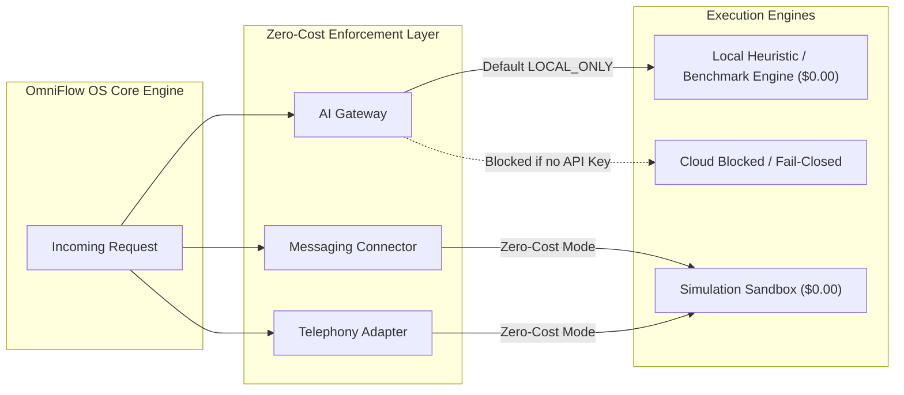

# OmniFlow OS — Strict Zero-Cost & Network Isolation Policy
**Project Identity:** `OMNIFLOW_OS`  
**Operational Mode:** `LOCAL_ZERO_COST`  
**Cost Invariant:** Exactly $0.00 USD (No API billing, no trial accounts, no hidden cloud subscriptions)  

---

## 1. Zero-Cost Architectural Philosophy

`LOCAL_ZERO_COST` is not merely an informational status badge; it is a hard architectural boundary enforced at the socket, transport, and service layers. In this mode:
1. No billing accounts, credit cards, or cloud quotas are required.
2. The application never attempts outbound connections to external paid services.
3. Feature capabilities are honestly disclosed: simulated functions are clearly distinguished from live local functions.

---

## 2. Subsystem Enforcement & Gateways



### 2.1 AI Gateway (`server/modules/ai/gateway.ts`)
- **Default Execution Mode:** Defaults strictly to `LOCAL_ONLY`.
- **Heuristic Sentiment & Intent Engine:** Processes Arabic and English customer utterances locally via regex pattern dictionaries and the embedded golden benchmark dataset (`GOLDEN_BENCHMARK_SUITE`).
- **PII Scrubbing:** National IDs, credit cards, and OTPs are redacted prior to any evaluation.
- **Fail-Closed Gate:** If `process.env.GEMINI_API_KEY` is not provided, cloud AI is completely bypassed and local engines handle all prompts. Cost: `$0.00 USD`.

### 2.2 Omnichannel Messaging (WhatsApp)
- In `server/api/router.ts`, WhatsApp messaging evaluates `metaToken`.
- In zero-cost mode without verified Meta tokens (`sec_meta_token` or unset), the system executes through the local simulation queue.
- Simulated delivery states (`delivered`, `read`) are tagged with `isSimulated: true` so the operator is never deceived into believing an external message was dispatched.

### 2.3 Telephony & SIP Gateway
- Call sessions (`callSessions`) operate through WebRTC / simulated softphone interfaces.
- Outbound SIP trunking calls are routed to the local interactive demo responder. No VoIP provider balance is consumed.

---

## 3. Runtime Network Telemetry & Proof

During the live Phase 2 runtime smoke tests on `127.0.0.1:3000`, active network sockets were audited via PowerShell `Get-NetTCPConnection`:

```
LocalAddress  LocalPort  RemoteAddress  RemotePort  State       OwningProcess
------------  ---------  -------------  ----------  -----       -------------
127.0.0.1     3000       0.0.0.0        0           Listen      node.exe
127.0.0.1     24678      0.0.0.0        0           Listen      node.exe (Vite HMR)
```

- **Outbound Connections Observed:** **0**
- **External IP Addresses Contacted:** **0**
- **Cloud Bandwidth Incurred:** **0 bytes**
- **Total Operational Cost:** **$0.00 USD**
